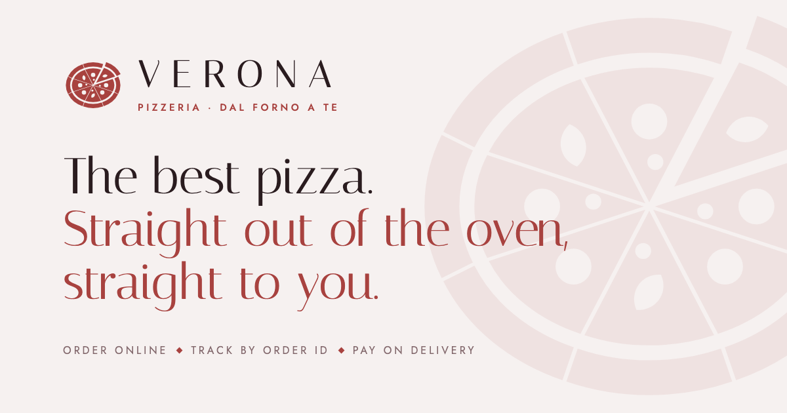
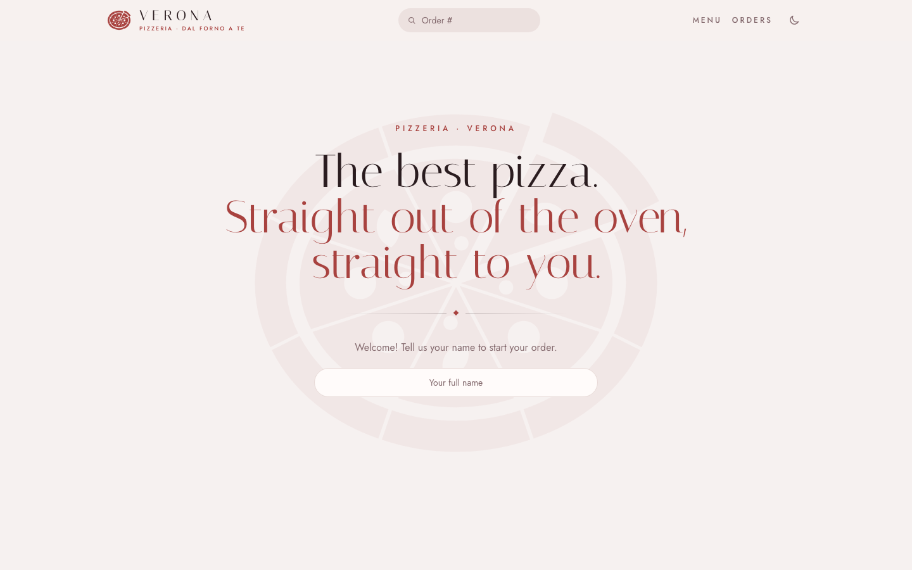
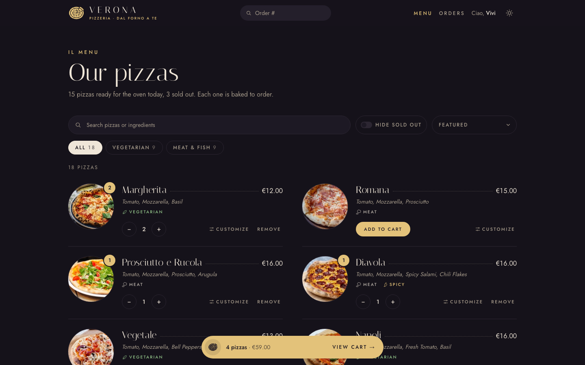
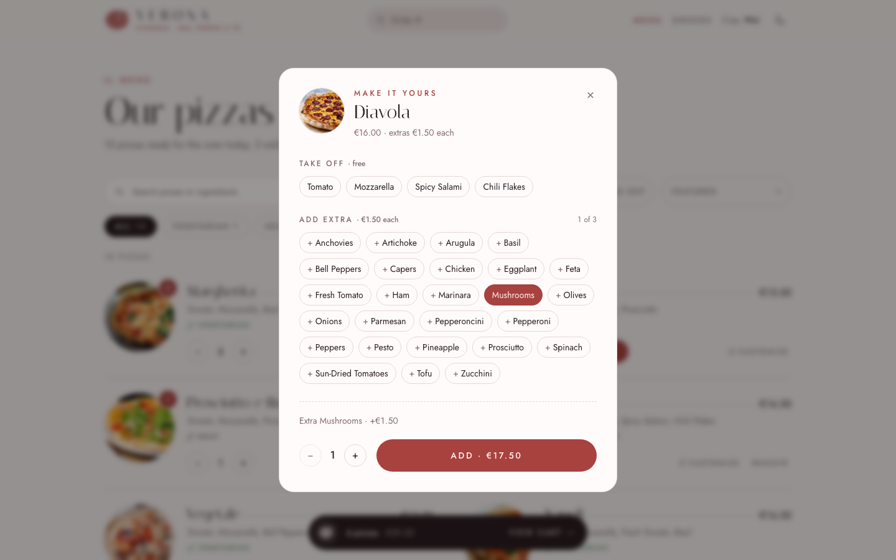
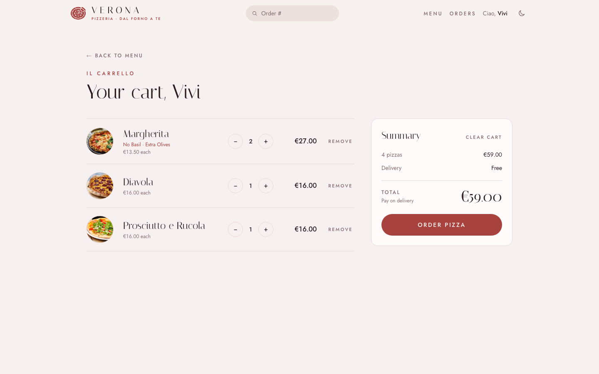
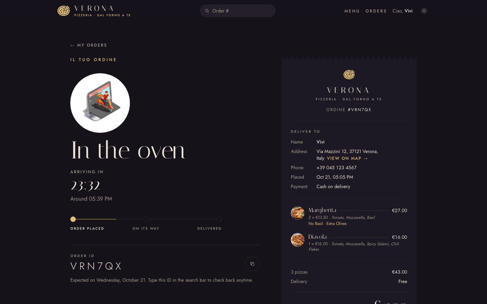

# Verona

**Pizzeria · dal forno a te** — an Italian pizza ordering app with a live order tracker, pizza customization and a light/dark theme inspired by the city of Verona.

**Live demo:** [verona.vivianaein.dev](https://verona.vivianaein.dev)



Verona started as the *Fast React Pizza* project from Jonas Schmedtmann's React course. I rebranded it and rebuilt most of the interface, then added features the course version doesn't have: pizza customization with topping prices, a live order tracker, order history with one-click reorder, menu search and filters, undo toasts and a full light/dark theme. It still uses the course's backend API, so everything new is built on the frontend.

## Screenshots

| Home | Menu (dark theme) |
| --- | --- |
|  |  |

| Customize a pizza | Cart |
| --- | --- |
|  |  |

| Live order tracking (dark theme) |
| --- |
|  |

## Features

**Ordering**
- Browse the menu with vegetarian, meat, fish and spicy tags
- Search by pizza name or ingredient, with the match highlighted
- Filter by diet, hide sold-out pizzas and sort by price or name; filters are saved in the URL, so a filtered menu can be shared
- Customize any pizza: take toppings off for free or add up to three extras at €1.50 each
- A pizza photo flies into the cart bar when you add it
- Two-column checkout with phone validation, "Use my location" to fill in the address, and optional priority delivery (+20%)

**After ordering**
- Live order page: the countdown ticks every second, the status refreshes every 30 seconds, and a progress line fills as delivery time approaches
- Receipt-style order details with delivery address, phone, topping changes and a copyable order ID
- My orders: every order placed on this device, with its current status, **Track** and **Order again**. Reordering uses today's prices and skips sold-out pizzas
- Look up any order by its ID from the header

**Experience**
- Light theme *Rosso Verona* and dark theme *Notte all'Arena*, following the system setting until you choose
- Cart, name and order history survive a page reload
- Undo for removing a pizza or clearing the cart
- Page transitions, loading placeholders shaped like each page, and designed 404 and error pages
- A page title for every page, including the live order status ("In the oven · Order #VRN7QX")
- Responsive from 360px phones to wide screens, with keyboard focus states and reduced-motion support

## What I added beyond the course

| | Course version | Verona |
| --- | --- | --- |
| Branding | Yellow theme, monospace font | Own name, logo, palette and typography |
| Theme | Light only | Light and dark, remembered per visitor |
| Menu | Plain list | Search, diet filters, sorting, tags, customization |
| Pizza toppings | Not supported | Add or remove toppings, priced per extra |
| Cart | Lost on reload | Saved in the browser, with undo |
| Order page | Static status | Live countdown, auto-refresh, progress line, receipt |
| Order history | None | My orders with one-click reorder |
| Loading | Full-screen spinner | Page-shaped skeletons and page transitions |
| Errors | "Unknown error" text | 404, order-not-found and retry pages |

## Design

- **Name:** Verona, the Italian city of Romeo and Juliet and of a Roman amphitheatre, the Arena, from 30 AD.
- **Logo:** the Arena seen from above is an oval ring around a central floor. Drawn simply, it's also a pizza, so the mark is an oval pizza with one slice pulled out.
- **Colors:** the light theme uses *Rosso Verona*, the pink-red marble the Arena is built from. The dark theme, *Notte all'Arena*, uses candle gold on deep violet, after the candles the audience lights at the Arena's summer opera.

  | Role | Light | Dark |
  | --- | --- | --- |
  | Accent | `#A8423F` | `#E3C27A` |
  | Background | `#F6F1F0` | `#15121A` |
  | Text | `#2A1C1F` | `#EFE6D8` |

- **Type:** [Italiana](https://fonts.google.com/specimen/Italiana) for the logo, headings and pizza names; [Jost](https://fonts.google.com/specimen/Jost) for everything you read or tap.

## Technical notes

The backend is the course's API, which I can't change. Most of the interesting work was getting more out of it:

- **No categories in the API.** Each pizza only has a name, price, photo, ingredients and a sold-out flag, so diet and spice tags are worked out from the ingredient list.
- **Filters without refetching.** Search and filters live in the URL query string. A `shouldRevalidate` on the menu route stops React Router from reloading the menu every time they change.
- **Hidden API fields.** Order items accept `addIngredients` and `removeIngredients`, which the course app never uses. I tested that the API stores them and keeps the line prices the app sends, so extra toppings show up correctly in the order total.
- **Cart lines.** Each cart line has an ID made from the pizza and its topping changes, so a plain Margherita and a Margherita with extra olives are separate lines.
- **No "list orders" endpoint.** The API can look up one order by ID but can't list them, so order history is a Redux slice saved to `localStorage`. The saved data is versioned and validated, and older carts are upgraded on load.
- **Privacy.** Looking up an order by ID leaves out the address and phone, so they're saved from the response when the order is placed and only shown on the device that placed it.
- **Live tracking.** A `useNow` hook ticks the countdown, and `useRevalidator` re-runs the order loader every 30 seconds while the tab is visible.
- **Loading states.** Skeletons are chosen from React Router's navigation state, with `HydrateFallback` for direct visits. View transitions use React Router's built-in `viewTransition` support.
- **Theming.** Colors are CSS variables stored as `R G B`, so Tailwind classes like `bg-accent/40` work in both themes. A small inline script applies the saved theme before first paint, so there's no flash of the wrong theme.
- **Performance.** The Lottie player is lazy-loaded only when an animation is on screen, and Vite's fingerprinted assets are cached for a year on Cloudflare.

## Tech stack

- [React 19](https://react.dev) and TypeScript
- [Vite 8](https://vite.dev)
- [React Router 7](https://reactrouter.com): loaders, actions, fetchers and view transitions
- [Redux Toolkit 2](https://redux-toolkit.js.org) and React Redux
- [Tailwind CSS 3](https://v3.tailwindcss.com)
- [dotLottie React](https://github.com/LottieFiles/dotlottie-web) for animations
- Hosted on [Cloudflare Pages](https://pages.cloudflare.com)

## Project structure

```text
src/
  features/
    cart/       Cart page, cart slice, undo actions, floating cart bar
    menu/       Menu, filters, search, customize dialog, menu skeleton
    order/      Checkout, order tracking, receipt, order history, reorder
    user/       Name and geolocation address
  hooks/        useNow, useScrolled, useTitle
  services/     API calls to the restaurant API and reverse geocoding
  ui/           Layout, header, logo, theme toggle, toasts, buttons, error pages
  utils/        Types, cart-line helpers, persistence, fly-to-cart animation
public/         Favicon, link-preview image, Cloudflare headers
```

## Getting started

You need Node.js 20.19+ or 22.12+ (required by Vite 8).

```bash
git clone git@github.com:naked-vivi/fast-pizza.git
cd fast-pizza
npm install
npm run dev
```

| Command | What it does |
| --- | --- |
| `npm run dev` | Start the dev server at http://localhost:5173 |
| `npm run build` | Typecheck and build to `dist/` |
| `npm run preview` | Serve the production build locally |
| `npm run lint` | Run ESLint |

No environment variables are needed; the app talks to the public course API.

## Deployment

The site is deployed on Cloudflare Pages:

- **Build command:** `npm run build`
- **Output directory:** `dist`

Cloudflare Pages serves `index.html` for app routes like `/menu` automatically, because the project has no `404.html`. Cache headers for the built assets are in [`public/_headers`](public/_headers).

## What I Learned

While building this project, I learned how to organize a React application by features instead of putting all components in one folder. This made the project easier to understand, maintain, and scale. I also learned how React Router loaders and actions can be used to fetch data and handle form submissions close to the routes that need them. This helped keep the code cleaner and more organized. Redux Toolkit helped me manage global state more easily, especially for user information and cart data. I also learned how useful derived selectors are for calculating totals, item quantities, and other values that are reused across different components. This project also helped me improve my TypeScript skills by using types with React components, route actions, API functions, and Redux state. I became more comfortable writing safer and more predictable code. For styling, I used Tailwind CSS to build responsive layouts quickly with utility classes. I also practiced handling asynchronous work such as API requests, geolocation, loading states, and error messages.

## Challenges

One of the main challenges in this project was managing the cart state across different pages while making sure the UI updated immediately whenever the user added, removed, or changed an item. Another challenge was handling form submissions with React Router actions while still validating the user’s input properly. I also had to work with external APIs, so I needed to handle failed requests and show helpful error messages instead of leaving the user confused. The geolocation feature was also a little challenging because it involved connecting browser permissions, coordinates, and reverse geocoding to fill in the user’s address smoothly. I also had to keep TypeScript types consistent across API data, Redux state, and component props. This helped make the code safer, but it required careful planning. Finally, I worked on making the interface responsive so the menu, cart, and order form could work well on different screen sizes.

## Credits

- Based on the *Fast React Pizza* project from [Jonas Schmedtmann](https://github.com/jonasschmedtmann)'s *The Ultimate React Course*. The menu, pizza photos and order API (`react-fast-pizza-api.jonas.io`) come from the course.
- Reverse geocoding by [BigDataCloud](https://www.bigdatacloud.com).
- Animations from [LottieFiles](https://lottiefiles.com).
- Fonts from [Google Fonts](https://fonts.google.com).

## Author

Built by [naked-vivi](https://github.com/naked-vivi).
